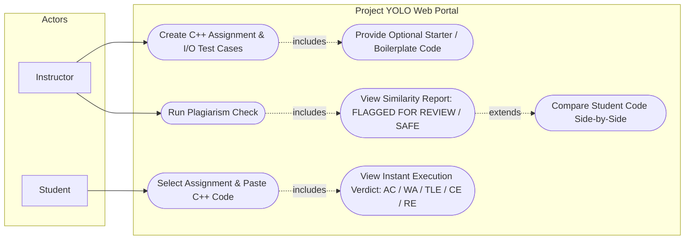
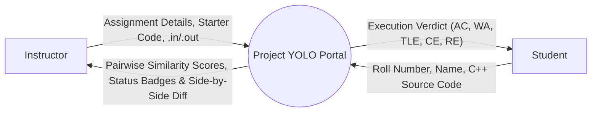
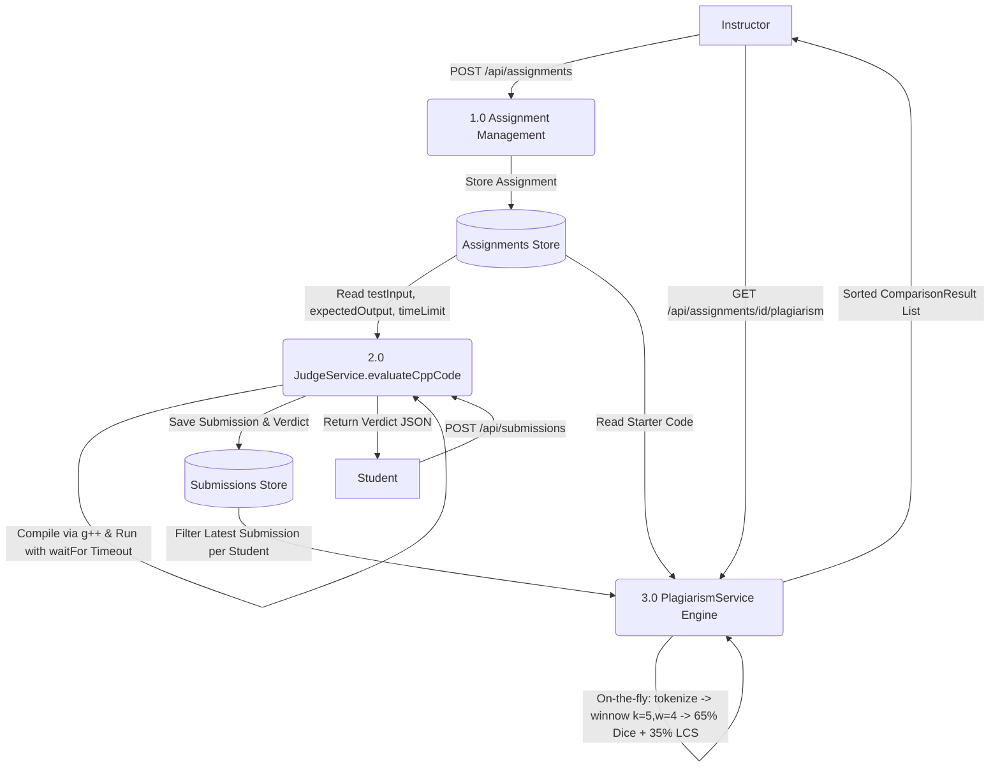
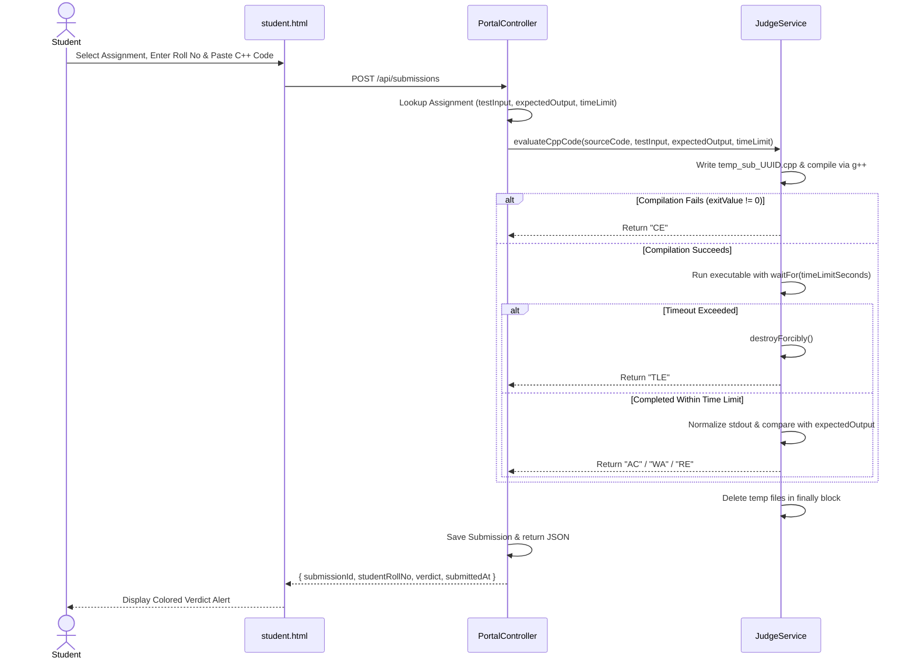
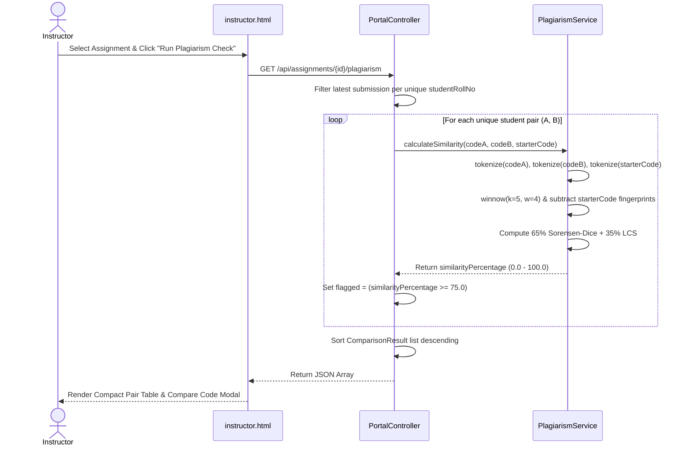
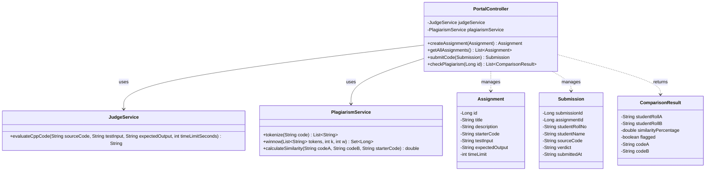

# System Design Diagrams — Project YOLO

## 1. Use Case Diagram

## 2. Data Flow Diagram — Level 0 (Context Diagram)

## 3. Data Flow Diagram — Level 1

## 4. Sequence Diagrams

### A. Student Code Submission & Judging Sequence

### B. On-the-Fly Plagiarism Check Sequence

## 5. Class Diagram
