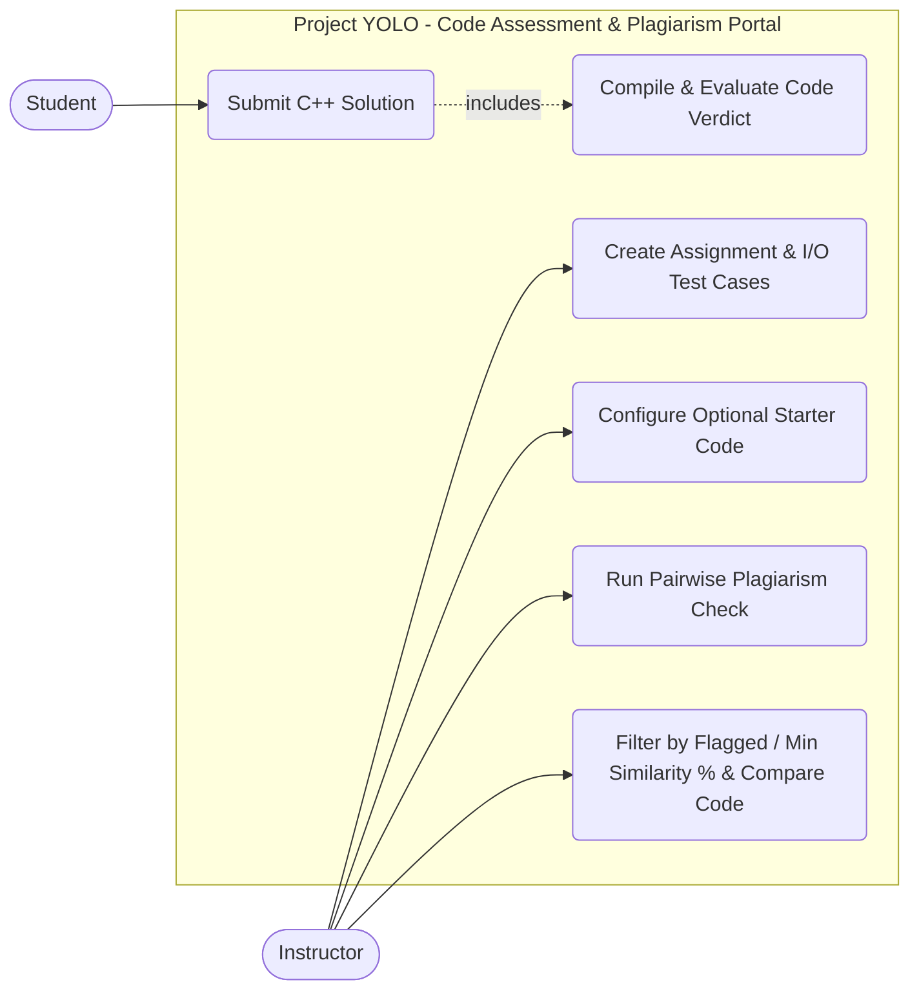
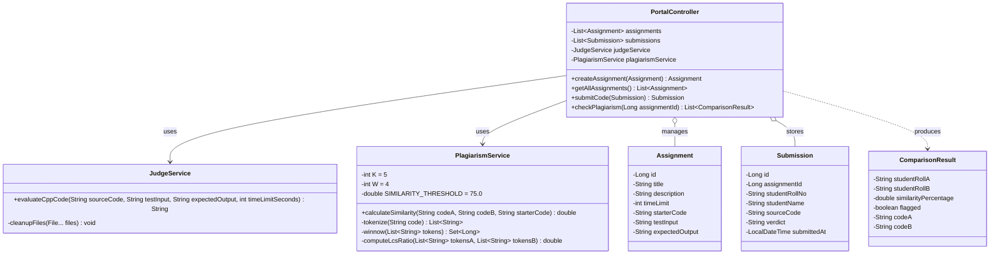
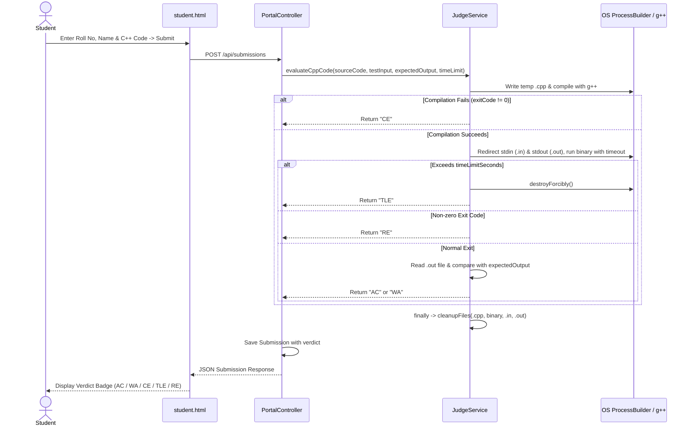
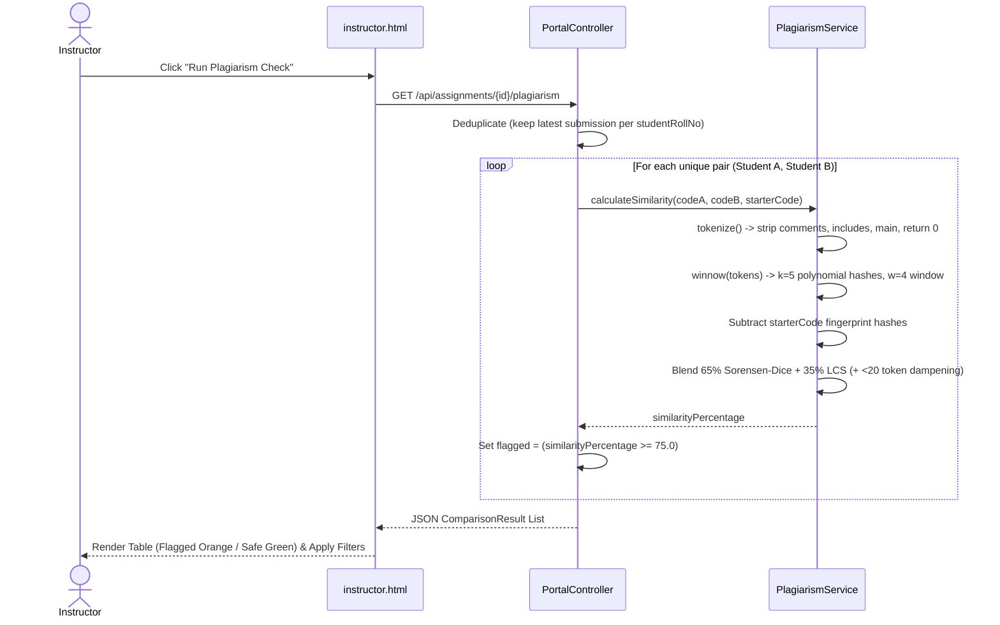
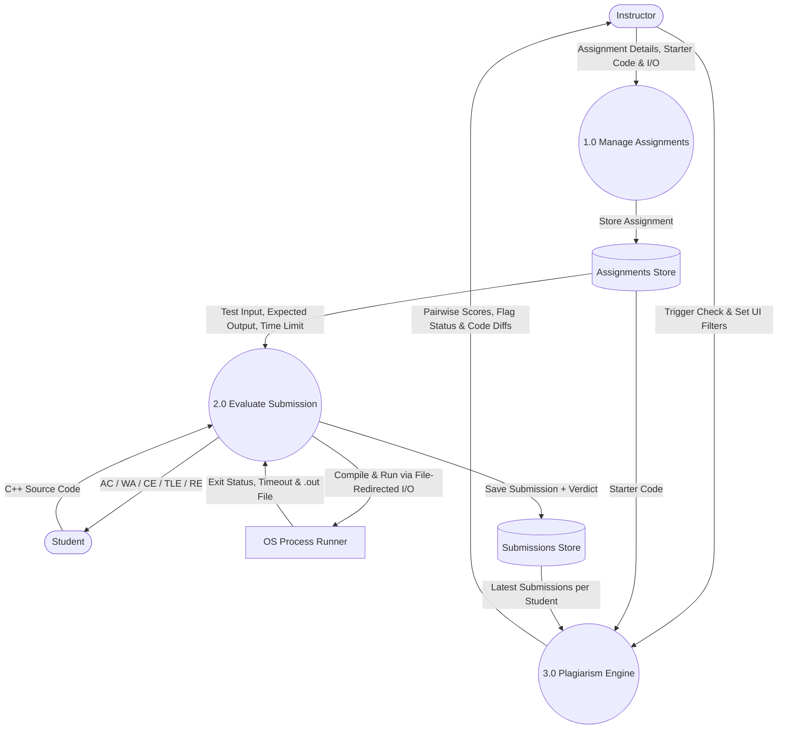

# System Design & UML Diagrams (Project YOLO)

## 1. Use Case Diagram

## 2. Class Diagram

## 3. Sequence Diagrams

### A. Code Submission & File-Redirected Judge Flow

### B. Plagiarism Detection & Filtering Flow

## 4. Data Flow Diagram (Level 1 DFD)
