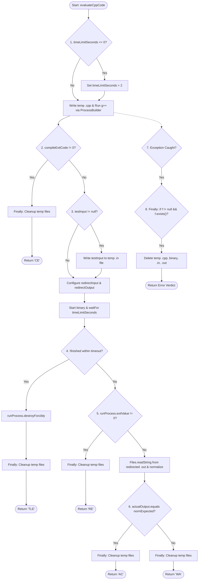

# Project Planning, Testing, Control Flow Graph & Risk Analysis

## 1. Project Planning & Effort Estimation (COCOMO)
We applied the Basic COCOMO model (Organic Mode) to estimate the theoretical baseline effort for Project YOLO:
* **Estimated Project Size:** 3.5 KLOC (Total Project Deliverable Scope)
  * *Justification:* Estimated across the complete project deliverable footprint (~1.5 KLOC for Spring Boot REST controllers, models, and core services; ~1.0 KLOC for JUnit 5 test suites and build/config files; and ~1.0 KLOC for the HTML/JS frontend UI and Mermaid/IEEE engineering documentation).
* **Organic Mode Constants:** `a = 2.4`, `b = 1.05`
* **Calculation:** `Effort (E) = a * (KLOC)^b = 2.4 * (3.5)^1.05 ≈ 8.95 Person-Months`

## 2. White-Box Testing: Control Flow Graph (CFG) & Cyclomatic Complexity
We performed white-box basis path analysis on `JudgeService.evaluateCppCode(String sourceCode, String testInput, String expectedOutput, int timeLimitSeconds)` (reflecting the Increment 2 file-redirected I/O implementation).

### Decision Points (Predicate Nodes) in `JudgeService.evaluateCppCode`
1. **Decision 1 (Time Limit Normalization):** `if (timeLimitSeconds <= 0)` -> defaults to `2` seconds.
2. **Decision 2 (Compilation Exit Code):** `if (compileExitCode != 0)` -> returns `"CE"`.
3. **Decision 3 (Test Input Presence Check):** `if (testInput != null)` -> writes `testInput` to temporary input file before process redirection.
4. **Decision 4 (Execution Timeout Check):** `if (!finished)` from `runProcess.waitFor(timeLimitSeconds, TimeUnit.SECONDS)` -> calls `destroyForcibly()` and returns `"TLE"`.
5. **Decision 5 (Runtime Exit Code Check):** `if (runProcess.exitValue() != 0)` -> returns `"RE"`.
6. **Decision 6 (Output Verdict Comparison):** `if (actualOutput.equals(normExpected))` -> returns `"AC"`, else returns `"WA"`.
7. **Decision 7 (Exception Handler):** `catch (Exception e)` block returning error verdict on process/IO failure.
8. **Decision 8 (Finally Temp File Cleanup Guard):** `if (f != null && f.exists())` inside cleanup helper/loop deleting temporary `.cpp`, binary, `.in`, and `.out` files.

### Cyclomatic Complexity Calculation
* **Number of Predicate / Decision Points (D):** `8`
* **Formula:** `V(G) = D + 1 = 8 + 1 = 9` (equivalently `V(G) = E - N + 2P = 9`)
* This yields **9 independent basis paths** covering default time-limit fallback, compilation error (`CE`), timeout (`TLE`), runtime error (`RE`), wrong answer (`WA`), accepted solution (`AC`), exception handling, and safe temporary file cleanup.

### Control Flow Graph (CFG) Diagram for `JudgeService.evaluateCppCode`

## 3. Software Testing Strategy (V-Model Mapping)
* **Unit Testing (White-Box):** Implemented in `PlagiarismServiceTest.java` using JUnit 5 to test `PlagiarismService` (`tokenize`, `winnow`, `calculateSimilarity`) across comments, preprocessor directives, `main`/`return 0;` stripping, variable renaming, starter-code exclusion, `< 20` token dampening, and `JudgeService.evaluateCppCode` timeout (`TLE`) handling.
* **Integration Testing:** When a student submits code via `POST /api/submissions`, `PortalController` invokes `JudgeService.evaluateCppCode` to evaluate the code and stores the submission with its verdict. When an instructor triggers `GET /api/assignments/{id}/plagiarism`, `PortalController` filters for the latest submission per student and invokes `PlagiarismService.calculateSimilarity` on the fly.
* **System & Acceptance Testing (Black-Box):** Partitioned test inputs into valid solutions (`AC`), compilation syntax errors (`CE`), wrong answers (`WA`), infinite `while(1)` loops (`TLE`), exact copies (Type-1), and variable-renamed / reformatted copies (Type-2).

### C++ Plagiarism Engine Experimental Results (`PlagiarismServiceTest`)
*(Verified against the latest local test suite execution)*  
All 7 JUnit 5 tests pass (`Tests run: 7, Failures: 0, Errors: 0`). Below are the exact similarity scores generated by `PlagiarismService` (`k = 5`, `w = 4`, 65% Sorensen-Dice + 35% LCS blend, `75.0%` threshold) across our 6 C++ similarity experiments:

| Experiment Type | Similarity Score | Engine Verdict (`>= 75%` Flagged) | UI Status Badge |
| :--- | :--- | :--- | :--- |
| 1. Exact Copy | 100.0% | FLAGGED | FLAGGED FOR REVIEW |
| 2. Copy with Renamed Variables | 100.0% | FLAGGED | FLAGGED FOR REVIEW |
| 3. Copy with Changed Formatting & Comments | 100.0% | FLAGGED | FLAGGED FOR REVIEW |
| 4. Binary Search vs Linear Search | 34.7% | SAFE | SAFE |
| 5. Two Independently Written Addition Programs | 21.5% | SAFE | SAFE |
| 6. Same Starter Code, Different Implementations | 21.7% | SAFE | SAFE |

## 4. Risk Mitigation, Monitoring, and Management (RMMM) Table
| Risk ID | Risk Description | Category | Probability | Impact | Mitigation Strategy (RMMM) |
| :--- | :--- | :--- | :--- | :--- | :--- |
| **R1** | Student code runs infinite `while(1)` loops or leaves temporary binaries/I/O files behind. | Technical / Security | High | High | **Implemented:** Process timeout (`waitFor` + `destroyForcibly`) and temp file cleanup in `finally`. **Planned/Future:** Docker container isolation. |
| **R2** | False-positive flags on short programs or shared starter boilerplate code. | Algorithmic | Medium | High | **Implemented:** Starter-code Winnowing hash subtraction (`k=5, w=4`), `< 20` token dampening, blended scoring (65% Sorensen-Dice + 35% LCS), 75% threshold, and side-by-side manual code review. |
| **R3** | Redundant comparisons when a student submits multiple attempts. | Performance | Medium | Medium | **Implemented:** Deduplicate submissions to compare only the latest attempt per `(assignmentId, studentRollNo)`. **Planned/Future:** Inverted fingerprint index for 100+ files. |
| **R4** | Schedule slippage before evaluation. | Project Schedule | Medium | High | **Implemented:** Followed the Incremental SDLC model with locked API contracts across branches. |
